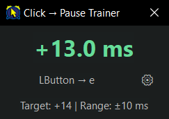

# Click → Pause Trainer 

A lightweight Windows utility for practicing millisecond-precise input timing, developed for speedrunning **Clustertruck**.

Click → Pause Trainer measures the time between two keyboard or mouse inputs and displays the result in real time, helping players develop the muscle memory needed for techniques like pause bouncing and whip bouncing.

The application runs in a small, always-on-top window, so you can practice while playing!

## Features

- **Live timing feedback** — Measures the delay between two inputs with millisecond precision.
- **Customizable inputs** — Use any keyboard key or mouse button, configured through the ⚙ button.
- **Adjustable target** — Set your ideal timing and acceptable range. Successful hits appear green.
- **In-game overlay** — Compact, draggable, always-on-top window that works over Clustertruck.
- **Persistent settings** — Automatically saves input bindings, timing preferences, and window position to an INI file.
- **Standalone executable** — No installation or AutoHotkey dependency required.

## Getting Started 

1. Download `ClickPauseTrainer.exe` from [Releases](../../releases).
2. Run the application. A configuration INI file will be generated automatically.
3. Practice your timing!

By default, the trainer measures the time between **Left Mouse Button → E**.

Positive values indicate that the first input arrived before the second. Negative values indicate the reverse.

Click the ⚙ button to reassign either input.

## Configuration

Settings are stored in `ClickPauseTrainer.ini`, beside the executable.

The timing settings default to:

- **Target:** +14 ms
- **Range:** ±10 ms

Edit these values in the INI file and restart the application to apply them. With the defaults, any timing between +4 ms and +24 ms counts as successful.

## About

This utility monitors your inputs and reports what you did AFTER you did it. It does **not** automate gameplay, generate inputs, or modify the game.

Developed for *Clustertruck* speedrunning, but usable for practicing input timing in any game or application.

Written in AutoHotkey v2.

**Created by Roninpawn & ChatGPT — October 14, 2026.** (in about 4 hours)
